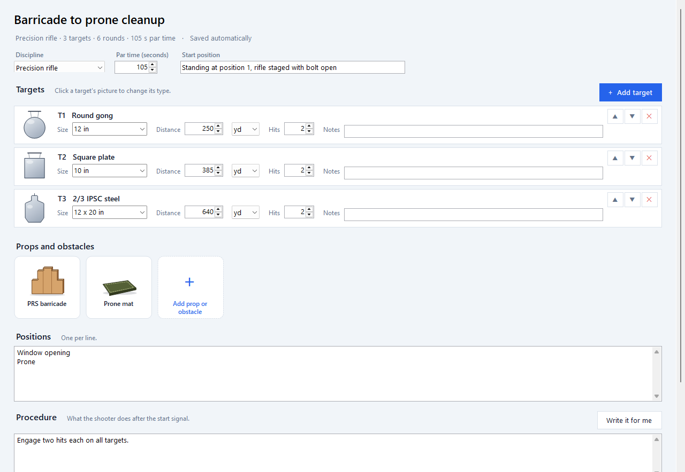
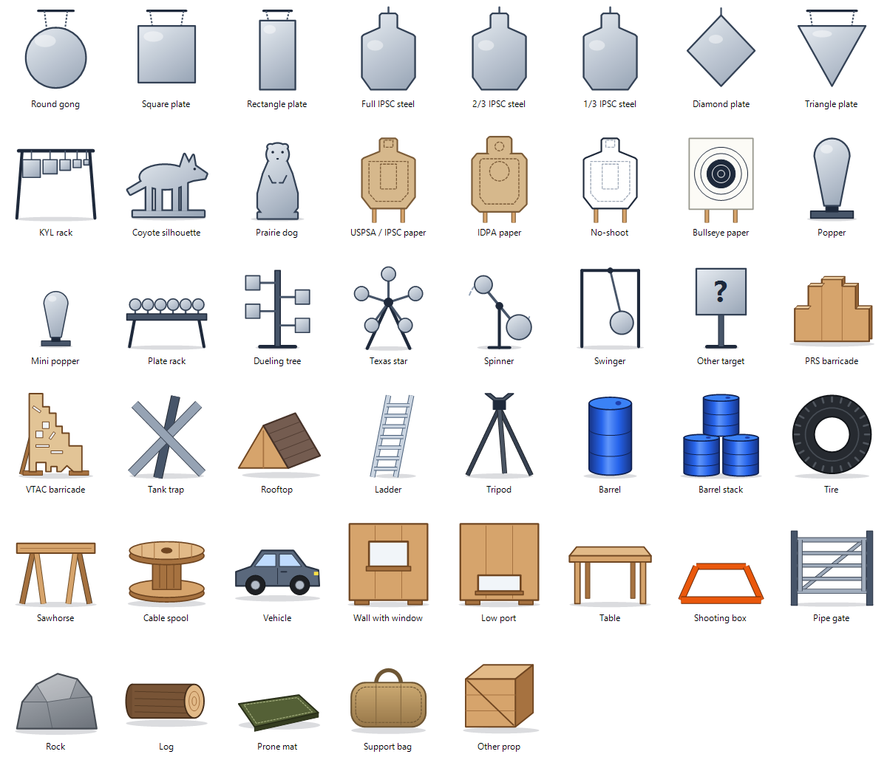
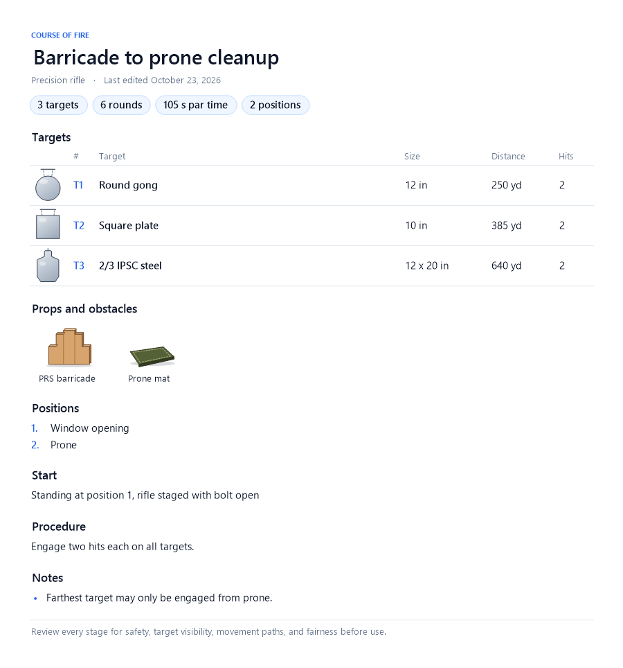

# Course of Fire Stage Generation Tool

Build, generate and print courses of fire for **PRS / precision rifle**, **NRL22 / rimfire** and **pistol / carbine** matches and practice.



## Features

- **Stage editor**: set targets (size, distance, hits), props, positions, par time and procedure. *Write it for me* drafts the procedure for you.
- **Target and prop catalog**: 23 targets and 22 props, each drawn to look like the real thing. Includes steel plates, IPSC/IDPA paper, reactive targets, and PRS and VTAC barricades.
- **Random stage generator**: enter what your range has, set the rules, and get stages built only from that equipment.
- **Print and export**: PDF, PNG, CSV and text, plus `.cof` files for sharing stages with other users.
- **Stage library**: saved automatically, searchable and backed up.
- **Starter content**: sample stages and PRS stage ideas.

| Catalog | Stage sheet |
| --- | --- |
|  |  |

## Requirements

Windows 10 (1903 or later) or Windows 11. The app runs on .NET Framework 4.8, which those versions of Windows already include.

## Build

You don't need Visual Studio:

```powershell
powershell -ExecutionPolicy Bypass -File build.ps1
```

This builds `bin\Course of Fire.exe`. To build somewhere else, add `-Out <path>`.

## Your data

Stages are saved to `%APPDATA%\CourseOfFire\library.json`, and the previous version is kept as `library.backup.json`.

## Adding a target or prop

1. Add an entry to `Catalog.Targets` or `Catalog.Props` in `src/Model.cs`.
2. Add a matching drawing to `DrawTarget` or `DrawProp` in `src/Icons.cs` (drawn on a 100 × 100 grid).
3. Rebuild.

Write the code in C# 5 so the compiler built into Windows can still build it.

## Safety

Have every stage reviewed by an RO or match director before you run it.
